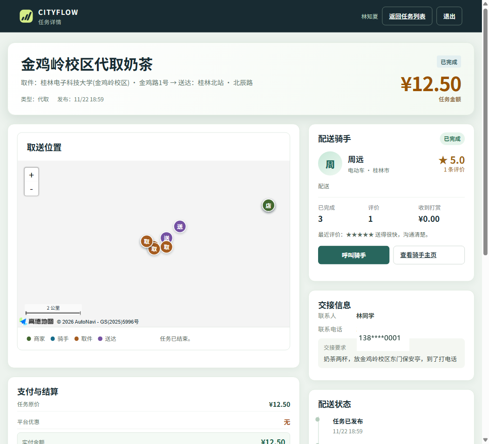
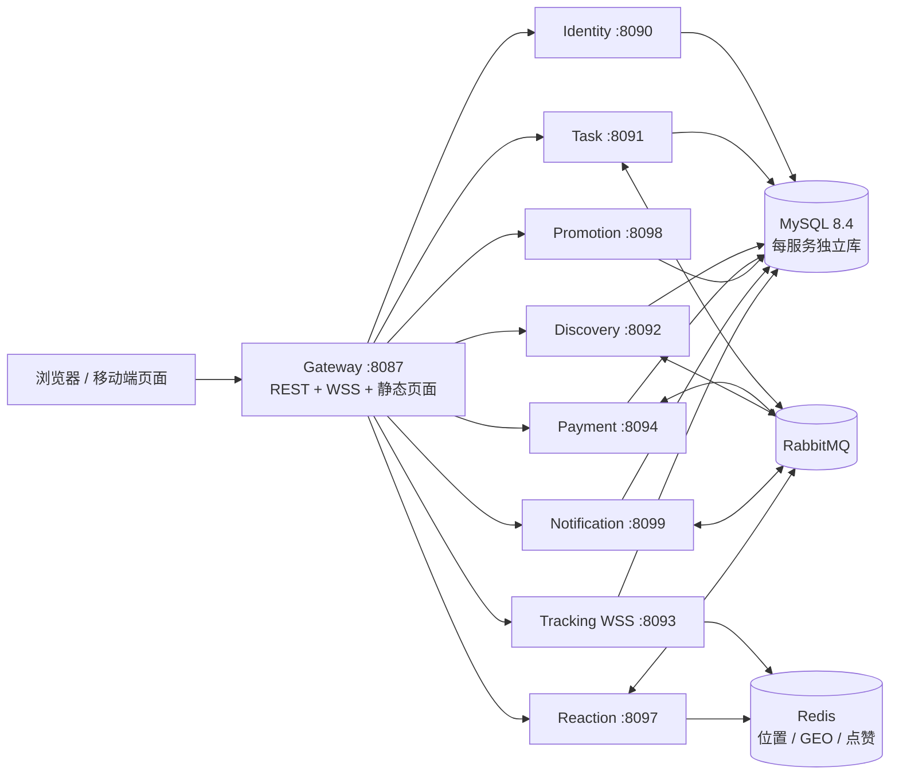
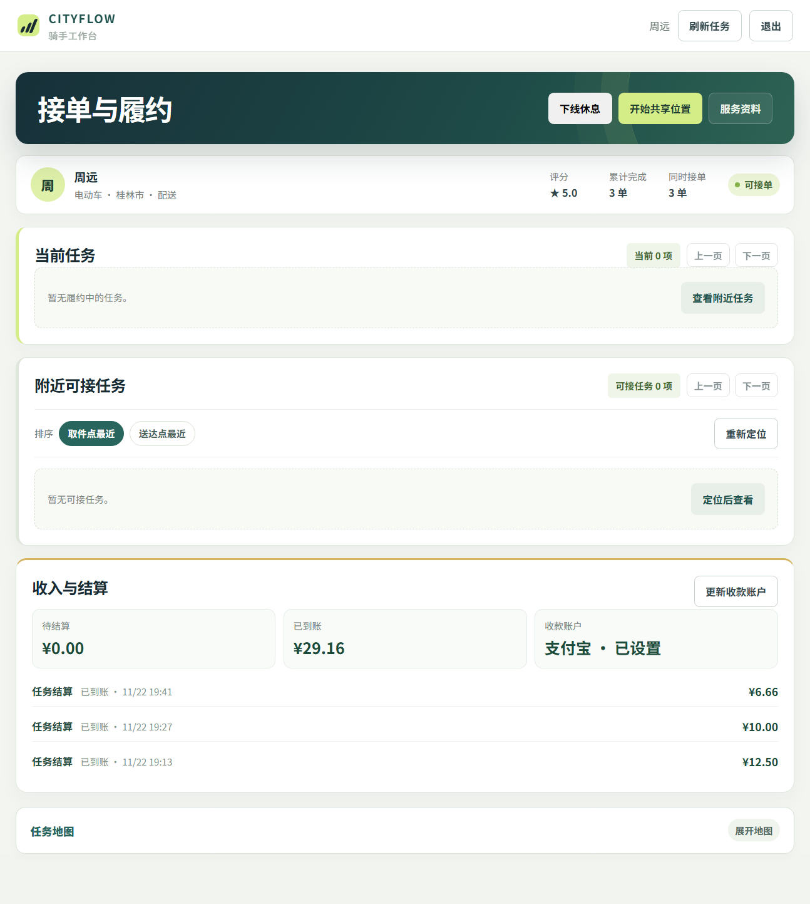
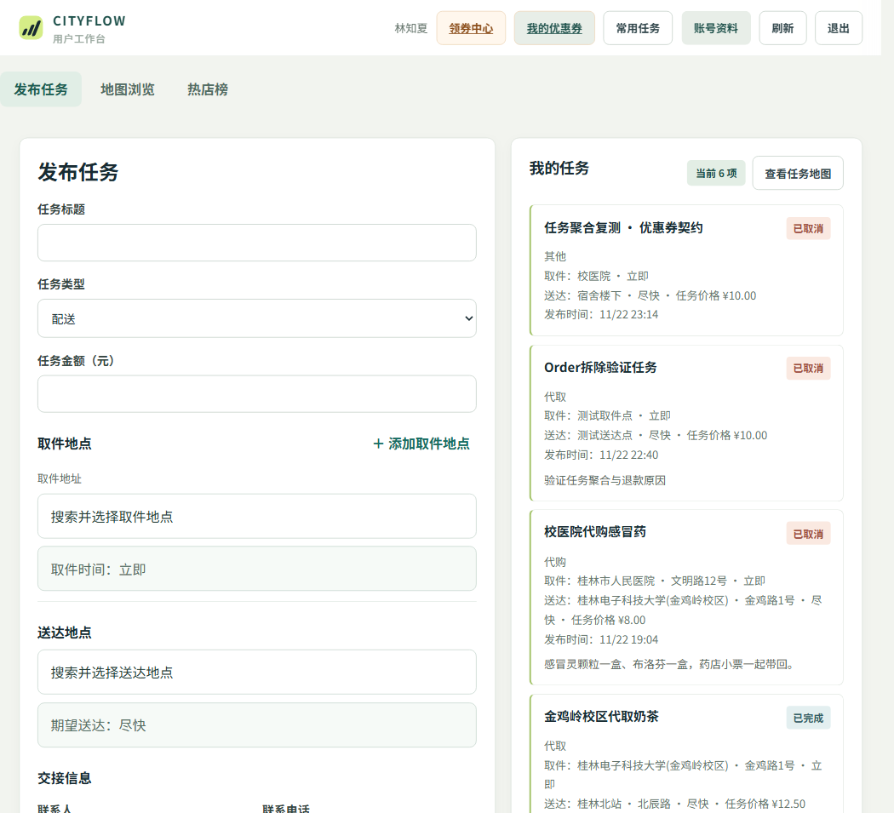
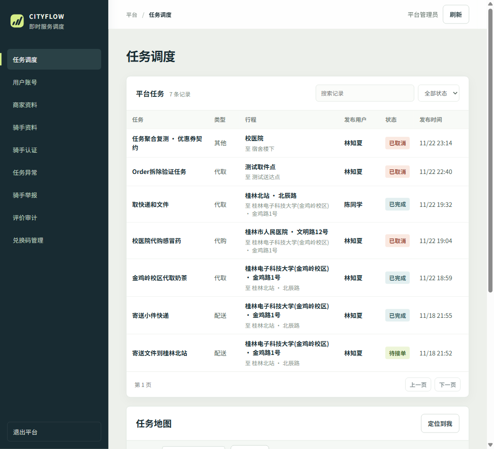

# CityFlow

> 面向校园与园区的即时任务调度平台。

<p align="center">
  
</p>
<p align="center"><sub>真实运行：用户林知夏完成一笔代取奶茶任务，骑手周远累计完成 3 单、获得 1 条评价，支付与骑手结算均已到账。</sub></p>

[](https://go.dev/)
[](https://github.com/zeromicro/go-zero)
[](https://www.mysql.com/)
[](https://redis.io/)
[](https://www.rabbitmq.com/)

## 目录

- [一、先看它真的能跑](#一先看它真的能跑)
- [二、这个项目解决什么问题](#二这个项目解决什么问题)
- [三、30 秒看懂](#三30-秒看懂)
- [四、做到什么程度](#四做到什么程度)
- [五、技术亮点](#五技术亮点)
- [六、整体架构](#六整体架构)
- [七、一条核心链路](#七一条核心链路)
- [八、实际运行](#八实际运行)
- [九、快速开始](#九快速开始)
- [十、工程难题](#十工程难题)
- [十一、当前边界](#十一当前边界)
- [十二、文档](#十二文档)

## 一、先看它真的能跑

| 能力 | 怎么操作 | 实际结果 | 证据 |
|---|---|---|---|
| 用户发布、支付、评价一条任务 | 用 `user@cityflow.local` 登录 `/user`，发布「金鸡岭校区代取奶茶」，支付后由骑手完成并评价 | 任务 `COMPLETED`，任务金额 ¥12.50；支付单 `PAID`，骑手结算单也是 `PAID`；骑手卡片显示 5.0 分、1 条评价、累计完成 3 单 | [任务详情截图](#八实际运行)；`GET /api/v1/tasks/d5a5d592-5856-42c2-aabf-9261240cb615/payment` 返回 `payment.status=PAID`、`settlement.status=PAID` |
| 骑手查看开放池与收入 | 用 `rider@cityflow.local` 登录 `/rider`，查看首屏和任务列表 | 周远累计完成 3 单；附近可接任务 0 项，未支付任务不出现在开放池；已到账 ¥29.16，对应 3 笔已完成任务结算 | [骑手工作台截图](#八实际运行)；`GET /api/v1/riders/me` 返回 `completed_tasks:3` |
| 平台按任务维度调度 | 用 `admin@cityflow.local` 登录 `/admin`，打开任务调度 | 7 条任务记录；发布用户显示「林知夏」「陈同学」，状态列只显示单个「已取消 / 已完成 / 待接单」 | [平台任务调度截图](#八实际运行) |
| 地图搜索本地商家 | 用户端 `/user` 地图搜索「桂电金鸡岭校园便利店」 | 搜索结果第一条是本地商家，`source=merchant`、`coordinate_system=WGS84`，不再只返回高德 POI | `GET /api/v1/map/search?keywords=桂电金鸡岭校园便利店&city=桂林市`；数据库商家 `6d06980e-8621-47dc-aeef-ea1a274ddabf` |

**一条完整用户链路**：林知夏从 `/user` 发布「金鸡岭校区代取奶茶」→ 支付 ¥12.50 → 周远接单、取件、送达 → 任务变为 `COMPLETED`，支付单和结算单变为 `PAID` → 用户给出 5 星评价，骑手卡片显示 1 条评价。截图见 [实际运行](#八实际运行)。

## 二、这个项目解决什么问题

CityFlow 是给校园和园区里的用户、兼职骑手、周边商家与平台运营共同使用的即时任务调度工具。它要解决的是“跑腿需求散落在群聊和私聊里，谁接、多少钱、到哪了、有没有付、出了问题找谁”这一串问题：口头约定的任务没有状态，骑手看不到可信的开放池，商家不知道自己还能接多少单，平台也无法回溯一笔任务的支付、位置和评价。

它不是“再做一个外卖下单页”。和普通 CRUD 任务板的区别有两点：第一，任务、支付、位置、评价各自有独立的数据所有者，靠任务状态机和支付门禁保证“没付钱的任务不能被接”；第二，骑手位置先写 Redis 热状态，再按批归档到 MySQL，实时展示和历史追溯分开处理，不让高频位置写拖垮主库。

## 三、30 秒看懂

| 谁 | 从哪里进 | 能做什么 | 做完看到什么 |
|---|---|---|---|
| 用户 | `/user` | 发布取送/代购任务、支付、取消、领券、评价骑手和商家、查看任务地图 | 任务状态、支付金额、骑手信息、评价与历史轨迹 |
| 骑手 | `/rider` | 上线、查看附近任务、接单、到达/取件/送达、收款账户、任务地图 | 当前任务、累计完成、评分、评价、待结算/已到账 |
| 商家 | `/merchant` | 建店、编辑营业资料、设置每小时容量、维护门店位置和图片 | 营业状态、容量、用户评价入口 |
| 平台 | `/admin` | 任务调度、账号/商家/骑手资料、骑手认证、异常与举报、评价审计、兑换码管理 | 任务台账、审核结果、异常处理结果、CSV 导出 |

## 四、做到什么程度

| 目标 | 判断标准 | 当前结果 | 证据 |
|---|---|---|---|
| 用户—支付—骑手—评价主链路跑通 | 一笔真实任务能从发布走到完成，支付和结算都能落状态 | 已达成 | 任务 `d5a5d592-5856-42c2-aabf-9261240cb615` 为 `COMPLETED`；支付单 `59165bf8-d142-4d45-90e2-7c0a4a8c9b1e` 为 `PAID`；结算单 `06f1b335-7a67-4074-92c4-8d5af5b1beed` 为 `PAID`；见任务详情截图 |
| 支付与任务不被 taskId/orderId 混淆 | 任务支付只按任务报价；同一任务最多一笔活跃支付单；未支付任务不能接单 | 已达成 | `payment_orders.active_task_id` 生成列 + 唯一索引；Task Claim 走 `PaymentGate.EnsureClaimable`；`go test ./app/payment/... ./app/task/...` 通过 |
| 位置流能订阅，轨迹能归档 | 进行中任务可建立 WSS；已完成/已取消任务拒绝；位置最终写入 `rider_track_points` | 部分达成 | 临时 `CLAIMED` 任务 WSS 握手返回 `Open`（101）；`COMPLETED` 任务返回 404；模拟上报 1 个位置后，`rider_track_points` 出现 1 条记录。多 Gateway 实例的实时广播尚未做桥接 |
| 评价与骑手统计同源 | 商家评价只能落到真实商家；骑手完成数和评价数来自任务/反馈事实 | 已达成 | `/api/v1/tasks/d5a5.../merchant-review-target` 返回 400「该任务没有可评价的商家地点」；`/api/v1/riders/me` 返回 `completed_tasks:3`；`/api/v1/tasks/6a946.../rider` 返回 `completed_tasks:3, review_count:1` |
| 干净环境能启动并自检 | 从空依赖启动基础设施、建库、起服务、`/readyz` 通过 | 部分达成 | 已用 `start-local.ps1` 重建并启动 9 个进程；`/readyz` 返回 `{"status":"ok"}`。本轮没有清空 Docker 数据卷做一次全新的空库重放 |

## 五、技术亮点

### 技术栈总览

| 层 | 技术 | 版本 | 在项目里做什么 | 边界 |
|---|---|---|---|---|
| 语言 / 框架 | Go + go-zero | Go 1.26.4；go-zero 1.7.3 | 9 个独立进程；Gateway 提供 REST/WSS，业务服务用 zRPC；HTTP 契约在 `gateway.api`，RPC 契约在各自 `.proto` | go-zero 负责路由、服务发现配置和 RPC 骨架，不替业务做跨库事务或事件一致性 |
| 持久化 | MySQL + GORM | MySQL 8.4.13；GORM 1.25.12 | 每个服务一个库：身份、任务、商家、支付、优惠、通知、轨迹；任务与支付靠本地事务、唯一约束保证不变量 | 服务之间不共享表、不跨库做外键或分布式事务 |
| 热状态 | Redis + go-redis | Redis 7.4.11；go-redis 9.7.0 | 骑手位置快照/GEO/待归档 ZSET；点赞集合与计数 ZSET；登录与限流辅助状态 | Redis 里的实时位置可以丢，历史轨迹以 MySQL 归档为准；点赞状态清空后不能假装全量可恢复 |
| 消息 | RabbitMQ | 4.1.8 | Task/Payment 的 Outbox 投递；任务事件通知；轨迹批量归档；点赞绝对计数投影 | 至少一次投递，消费端必须用 inbox/唯一键做幂等，不能把 MQ 当唯一数据源 |
| 前端 | 原生 JavaScript + 高德 JS API 2.0 / Leaflet 1.9.4 | 高德 JS API 2.0；Leaflet 1.9.4 | Gateway 直接托管单页应用；地图、任务表单、角色工作台都在浏览器里运行，没有前端构建步骤 | 不是四个独立前端应用，也没有 SSR；Node 只用于语法检查，不是运行时依赖 |
| 实时 / RPC | gorilla/websocket + gRPC | gorilla/websocket 1.5.3；gRPC 1.65.0 | 任务位置流用 WebSocket 子协议携带 JWT；服务间同步查询/命令走 gRPC | 当前实时事件总线是单 Gateway 进程内广播，多实例需要额外桥接 |
| 部署 / 任务 | Docker Compose + PowerShell 7 + 可选 XXL-JOB | Docker Compose v2；PowerShell 7.6.4；XXL-JOB 可选 | 本地拉起 MySQL/Redis/RabbitMQ/PostGIS；`start-local.ps1` 负责建库、构建、起进程和健康检查；Payment 可接 XXL-JOB 调度对账 | 面向本地开发；不是生产级编排、监控和自动扩缩容方案 |

**核心链路**：Go + go-zero + MySQL + RabbitMQ。  
**支撑设施**：Redis 热状态、高德/Leaflet 地图、原生前端、PowerShell/Docker Compose。  
**仅演示 / 未接入运行路径**：支付默认走 `MOCK` 渠道，支付宝/微信适配器需要真实商户凭证和公网 HTTPS 回调；PostGIS 容器仍启动，但当前地图搜索走 AMap；XXL-JOB 是可选调度，不是本地默认启动项。

### 亮点一：支付按 task 建单，靠唯一活跃单和接单门禁守住一致性

**业务问题**：旧链路把任务 ID 直接当订单 ID 去查优惠券，支付成功后又调用 `Order.MarkPaid`，结果一边是优惠券 404，一边是“支付成功但订单没回写”。如果继续让客户端传金额、或者允许同一任务重复建支付单，后面退款、对账和结算都会对不上。

**设计选择**：Payment 以 `payment_orders` 为唯一支付事实，订单直接保存 `task_id`，金额只从 Task 的任务报价读取；`active_task_id` 是生成列，只为 `PENDING/PAID/REFUND_PENDING` 生成值，并加唯一索引，保证“一任务一活跃支付单”。Task 接单前通过 `PaymentGate.EnsureClaimable` 回查付款状态；任务完成后再由结算 worker 建结算单，而不是在支付回调里直接改任务状态。

**证据**：
- 入口：`app/gateway/cmd/api/internal/handler/payments.go`、`app/gateway/cmd/api/internal/handler/tasks.go`
- 关键实现：`app/payment/application/payment/payment_service.go`、`internal/migrations/service/payment_001_payment.sql`
- 验证：`GET /api/v1/tasks/d5a5.../payment` 返回支付 `PAID`、结算 `PAID`；`go test ./app/payment/... ./app/task/...`

### 亮点二：位置先写 Redis 热状态，再按批归档 MySQL

**业务问题**：骑手大约每 10 秒上报一次位置。如果每次都同步写 MySQL，任务地图、开放池和历史轨迹会被同一张表的高频写拖慢；但只写 Redis 又会在进程重启或缓存淘汰后丢掉可追溯的履约证据。

**设计选择**：上报先走 Redis Lua，一次性更新位置快照、GEO 索引、已见集合和待归档 ZSET；`TrackArchiver` 每 5 秒取一批待归档位置，发布 `rider.track.batch.v1`，消费者写 `rider_track_points` 后再从 ZSET 移除。MySQL 侧用 `(rider_id, version)` 唯一键兜住重复投递，启动时还会扫描旧格式的 `track:rider:*` 回填。

**证据**：
- 入口：`app/gateway/cmd/api/internal/handler/tracking.go`
- 关键实现：`app/tracking/application/tracking/tracking_service.go`、`app/tracking/cmd/rpc/internal/svc/track_archive.go`、`app/tracking/cmd/rpc/internal/stream/stream.go`
- 验证：用骑手令牌上报一次 `simulated` 位置后，`cityflow_tracking.rider_track_points` 出现 1 条记录，`rider_id=...0003`；进行中任务 WSS 返回 101，已完成任务返回 404

### 亮点三：评价目标只认真实商家，骑手统计回到任务事实

**业务问题**：地图 POI 曾被直接当成商家，用户在已完成任务里写“商家评价”，结果写进了平台评价审计，商家端却看不到；骑手的 `completed_tasks` 又依赖一个没人维护的旧列，完成 3 单仍显示 0 单，任务卡上的评价数也和评价区对不上。

**设计选择**：`merchant-review-target` 只通过 `FindMerchantByAMapPOI` 解析真实收录商家，查不到就返回“该任务没有可评价的商家地点”；POI 详情和商家详情在页面上分开，纯 POI 不再展示商家评价表单。骑手累计完成数改为按 `tasks.status='COMPLETED'` 聚合覆盖，任务骑手卡的 `review_count` 从反馈事实计算，不再相信旧投影列。

**证据**：
- 入口：`app/gateway/cmd/api/internal/handler/discovery.go`（商家评价）、`app/gateway/cmd/api/internal/handler/rider_ops.go`（任务骑手卡）
- 关键实现：`app/discovery/application/review/merchant_reviews.go`、`app/task/internal/adapter/mysql/rider_repository.go`
- 验证：`POST /api/v1/tasks/d5a5.../merchant-review-target` 返回 400；`GET /api/v1/riders/me` 返回 `completed_tasks:3`；`GET /api/v1/tasks/6a946.../rider` 返回 `completed_tasks:3, review_count:1`；任务详情截图显示 5 星与“送得很快，沟通清楚。”

### 亮点四：本地事务写 Outbox，消费者用 inbox 和唯一键做幂等

**业务问题**：任务完成、取消、支付回调、结算之间如果直接双写数据库和 MQ，进程在写完数据库、还没发消息时崩掉，就会出现“任务完成了但通知没发、结算没建”；消息重复投递又会造成重复结算或重复退款。

**设计选择**：Task 在任务状态变更的同一个 MySQL 事务里写 `task_outbox`，由 relay 投递到 RabbitMQ；Payment 用 `payment_inbox` 记录已消费事件 ID，重复消息直接跳过。支付单、结算单各自有唯一键和状态 CAS；结算 worker 用 `FOR UPDATE SKIP LOCKED` 加租约取单，失败按重试次数推进，可能已出款时再用 `QueryPayout` 决定 `PAID/FAILED/UNKNOWN`。

**证据**：
- 入口：`app/gateway/cmd/api/internal/handler/tasks.go`、`app/gateway/cmd/api/internal/handler/payments.go`
- 关键实现：`app/task/internal/adapter/mysql/outbox.go`、`app/payment/application/payment/payment_inbox.go`、`app/payment/application/payment/payment_settlement.go`
- 验证：真实任务 `d5a5...` 的结算单在任务完成后变为 `PAID`；`go test ./app/task/... ./app/payment/...` 覆盖重复回调、结算重试和取消退款分支

## 六、整体架构



| 层 | 职责 | 关键模块 | 不负责什么 |
|---|---|---|---|
| 入口层 | 鉴权、路由、限流、静态页面、WSS 代理 | `app/gateway` | 不拥有任务/支付状态；不替下游做业务校验 |
| 业务层 | 账号、任务状态机、商家与地图、支付/结算、优惠券、通知、位置、点赞 | `identity`、`task`、`discovery`、`payment`、`promotion`、`tracking`、`notification`、`reaction` | 不读别的服务的表，不 import 别的服务的 domain |
| 异步 / 任务层 | Outbox 投递、inbox 去重、轨迹归档、点赞投影、结算重试 | Task outbox relay、Payment settlement worker、Tracking TrackArchiver、Reaction projector | 不是唯一数据源；消息丢失必须能从业务表/待归档队列恢复 |
| 数据层 | 持久化、热状态、消息 | MySQL、Redis、RabbitMQ | 不反向调用业务接口，不承担业务规则 |

完整服务清单和数据所有权见 [`docs/architecture/microservices.md`](docs/architecture/microservices.md)。

## 七、一条核心链路

以「用户发布一笔代取奶茶并完成评价」为例：

| 阶段 | 发生什么（含写入） | 谁负责 | 失败会怎样 | 证据 |
|---|---|---|---|---|
| 1. 入口 | 用户登录 `/user`，填写取件点、送达点、金额和联系人，`POST /api/v1/tasks` | Gateway | 未登录返回 401；请求体非法返回 400 | `gateway.api` 的 `post /api/v1/tasks` |
| 2. 校验 | 校验任务归属、取送地点、金额、联系人；任务 ID 和幂等键由服务端生成/校验 | Task application | 地点无效或金额非法时拒绝，不写任务；重复幂等键返回已有任务 | `app/task/application/task/task_service.go` |
| 3. 业务处理 | Task 建 `OPEN` 任务；用户创建支付单，Payment 读取任务报价；支付回调把支付单推进到 `PAID`；骑手接单前 Payment 回查可接单状态 | Task + Payment | 未支付时骑手接单返回 409；Payment 暂时不可用时开放池按可见性 fail-open，但接单仍强校验 | `app/task/application/task/task_service.go`、`app/payment/application/payment/payment_service.go` |
| 4. 持久化 | Task 写 `tasks`、`task_events`、`task_outbox`；Payment 写 `payment_orders`、`payment_notifies`、`rider_settlements` | 各服务 repository | 事务失败回滚；活跃支付单冲突由唯一索引兜住；重复回调由 inbox/CAS 拒绝 | `payment_001_payment.sql`、`app/task/internal/adapter/mysql/outbox.go` |
| 5. 异步 / 回调 | `task.created/completed/cancelled` 经 Outbox 进 RabbitMQ；Notification 写站内信；Payment 建结算单并重试出款 | Outbox relay、Payment worker、Notification consumer | 消息至少一次；消费端按事件 ID 去重；结算失败保留 `PENDING/FAILED/UNKNOWN` 并重试 | `app/payment/application/payment/payment_settlement.go` |
| 6. 结果 | 任务详情显示 `COMPLETED`、支付 `PAID`、结算 `PAID`；用户评价骑手后，骑手卡片显示 1 条评价、累计 3 单 | Gateway 页面 + Task/Payment API | 最终一致前页面显示“待结算/处理中”，不假装已到账 | [任务详情截图](#八实际运行) |

```text
登录 /user
  → POST /api/v1/tasks
  → Task 校验并写 tasks + task_events + task_outbox
  → POST /api/v1/tasks/{id}/payment
  → Payment 按任务报价建唯一活跃支付单
  → 支付回调 / Mock 支付 → payment_orders = PAID
  → 骑手接单（Payment.EnsureClaimable 通过）
  → 取件 / 送达 → Task = COMPLETED
  → Outbox → Notification / Payment settlement
  → 用户评价 → rider_feedback + 骑手统计
```

## 八、实际运行

### 用户：完成一笔代取任务后，支付和结算都能对上


*真实运行：林知夏从 `/user` 发布「金鸡岭校区代取奶茶」，支付 ¥12.50；周远完成后，任务显示 `已完成`，骑手卡片显示 5.0 分、1 条评价、累计完成 3 单；支付与结算状态均为已支付。*

### 骑手：累计完成 3 单，开放池不再混入未支付任务

<p align="center"></p>

*真实运行：周远登录 `/rider`，首屏显示累计完成 3 单、当前任务 0 项、附近可接任务 0 项；未支付的「寄送文件到桂林北站」没有进入开放池；收入与结算显示已到账 ¥29.16，对应 3 笔任务结算。*

### 用户工作台：发布任务和我的任务在同一页



*真实运行：林知夏在 `/user` 左侧填写取件点/送达点/金额，右侧「我的任务」列出 6 条记录，能看到已取消、已完成状态和每笔任务的金额、地点、发布时间。*

### 平台：任务调度显示发布人姓名和单一状态



*真实运行：平台管理员打开 `/admin` 的任务调度，7 条任务按时间列出；发布用户列显示「林知夏」「陈同学」而不是 UUID，状态列只显示一个状态标签，不再出现“已取消 · 等待接单”。*

## 九、快速开始

### 运行

**前置条件**：Go 1.26+（实测 1.26.4）、Docker Desktop、PowerShell 7、MySQL 客户端；Node 仅用于前端语法检查，不参与运行。

```powershell
# 1. 准备本地配置（两个文件都已被 .gitignore 忽略）
Copy-Item configs/local.env.example .env
Copy-Item deploy/.env.example deploy/.env
# 按本机情况填写 .env 与 deploy/.env 中的数据库、Redis、RabbitMQ、JWT 配置

# 2. 启动基础设施
docker compose -f deploy/docker-compose.yml up -d

# 3. 建库、构建并启动 9 个进程
.\scripts\microservices\start-local.ps1 -Build -SkipDocker

# 4. 打开
# http://localhost:8087/login
```

`start-local.ps1` 会调用 `scripts/db/init-service-databases.ps1` 创建 7 个服务库和账号，按依赖顺序启动服务，最后等待 Gateway 的 `/readyz`。如果 Docker 基础设施已经在运行，可以保留 `-SkipDocker`。

演示账号密码统一为 `cityflow123`：

| 账号 | 角色 |
|---|---|
| `user@cityflow.local` | 用户（林知夏） |
| `merchant@cityflow.local` | 商家（桂电金鸡岭校园便利店） |
| `rider@cityflow.local` | 骑手（周远） |
| `admin@cityflow.local` | 平台管理员 |

停止本地进程但保留 Docker：

```powershell
.\scripts\microservices\stop-local.ps1
```

### 验证

```powershell
# 就绪检查：应返回 status=ok
Invoke-RestMethod http://127.0.0.1:8087/readyz

# 登录并读到演示用户
$body = @{ email = 'user@cityflow.local'; password = 'cityflow123' } | ConvertTo-Json
(Invoke-RestMethod -Method Post -Uri http://127.0.0.1:8087/api/v1/auth/login -ContentType 'application/json' -Body $body).user.name

# 静态检查和全量测试
.\scripts\check.ps1
```

**预期结果**：`/readyz` 返回 `{"status":"ok"}`；登录返回 `林知夏`；`check.ps1` 输出 `All checks passed.` 测试依赖本机 Redis/MySQL，按 `.env` 配置 `CITYFLOW_TEST_REDIS_ADDR` 与 `CITYFLOW_TEST_TRACKING_DSN` 后再跑全量用例。

## 十、工程难题

### 难题一：一个 taskId 既当订单号又当支付号，支付成功却回写不到订单

**现象**：任务支付弹窗提示“可用券查询失败”，因为 `ListOrderCoupons` 把路径里的 taskId 直接查订单；支付侧又出现 `Order.MarkPaid ... order not found`，支付成功和订单状态对不上。

**根因**：任务支付没有建立 taskId 到支付单的映射，支付域还在依赖一个不属于自己的 Order 聚合；客户端金额、支付单和任务报价之间没有唯一约束。

**解决**：删除 Order 回写路径，Payment 直接按 `task_id` 保存支付单；`active_task_id` 生成列加唯一索引保证一任务一活跃支付单；Task 接单前调 `PaymentGate.EnsureClaimable` 回查付款状态；金额只从任务报价取。

**怎么验证**：用演示任务查询 `GET /api/v1/tasks/d5a5.../payment`，支付单和结算单都为 `PAID`；重复建支付单应返回已有/冲突而不是新建第二笔；`go test ./app/payment/... ./app/task/...` 覆盖回调重试和接单门禁。

**代码位置**：`app/payment/application/payment/payment_service.go`、`app/task/application/task/task_service.go`、`internal/migrations/service/payment_001_payment.sql`

### 难题二：任务归属正确却一直 403，WebSocket 被状态大小写拦死

**现象**：骑手 JWT 的 `sub` 与任务 `worker_id` 一致，REST 也能读到任务，但位置流握手持续 403；前端地图一直显示“该任务还没有位置记录”。

**根因**：`CanTrack` 用 `"Open" / "Completed" / "Cancelled"` 比较，而数据库和接口实际是 `OPEN / COMPLETED / CANCELLED`；状态分支完全失效，终态任务也没有被正确拒绝。

**解决**：统一 `strings.ToUpper(item.Status)` 后再判断；显式把 `OPEN`、`COMPLETED`、`CANCELLED` 和无 worker 的任务归为不可订阅；WSS 仍只从 `Sec-WebSocket-Protocol: bearer.<token>` 取身份，不信任频道名。

**怎么验证**：临时把一笔任务置为 `CLAIMED` 后，用骑手令牌连接，WebSocket 状态为 `Open`（101）；把任务标为 `COMPLETED`，同一路径返回 404；真实任务 `6a946...` 的终态订阅不再出现 403。

**代码位置**：`app/tracking/application/tracking/tracking_service.go`、`app/tracking/cmd/rpc/internal/stream/stream.go`

### 难题三：开放池要“只看已付款任务”，但付款状态在另一个服务

**现象**：未支付任务 `86a4708d...` 曾出现在骑手附近列表，骑手能点“接下任务”，服务端才返回 409；如果直接在前端隐藏，换个入口仍然能绕过。

**根因**：开放池由 Task 生成，付款状态由 Payment 拥有；列表查询没有回查 Payment，任务状态和付款状态是两套事实。

**解决**：Rider 的 `status=OPEN` 改走 `Task.ListOpenTasks`；Task 对每个候选调 `OpenPoolVisible`，内部用 `PaymentGate.EnsureClaimable` 判断；不可见任务直接从列表过滤。Payment 暂时故障时记录日志并 fail-open（保留任务可见），但实际接单仍走 Payment 强校验，避免因支付服务抖动把整个开放池清空。

**怎么验证**：骑手 `GET /api/v1/tasks?status=OPEN&limit=50` 返回空数组，未支付的 `86a4708d...` 不再出现；直接 `POST /tasks/86a.../claim` 返回 409。

**代码位置**：`app/gateway/cmd/api/internal/handler/tasks.go`、`app/task/application/task/task_service.go`、`app/task/application/rider/rider_service.go`

### 难题四：完成 3 单却显示 0 单，投影列和事实表各说各话

**现象**：骑手完成多笔任务后，`/api/v1/riders/me` 仍返回 `completed_tasks:0`；任务卡显示“0 条评价”，下方评价区却有 1 条内容。

**根因**：旧 `rider_profiles.completed_tasks` 被当作只读投影，没有事件流维护；评价数也没有从 `rider_feedback` 计算，页面不同区域读了两个来源。

**解决**：`RiderForUser`、`GetRider`、`ListRiders` 都按 `tasks.status='COMPLETED'` 聚合覆盖 `CompletedTasks`，不再信任旧列；任务骑手接口和公开骑手资料从反馈事实计算 `review_count`。

**怎么验证**：`GET /api/v1/riders/me` 返回 `completed_tasks:3`；`GET /api/v1/tasks/6a946.../rider` 返回 `completed_tasks:3, review_count:1`，并带最近的“送得很快，沟通清楚。”评价。

**代码位置**：`app/task/internal/adapter/mysql/rider_repository.go`、`app/task/application/rider/rider_service.go`

### 难题五：两个取件点都已取件，整单却还停在 CLAIMED

**现象**：双取件点任务两个 `PICKUP_n_PICKED_UP` 事件都完成后，整单仍是 `CLAIMED`，骑手必须再手动点“到达取件点”和“开始配送”，页面才出现“确认送达”。

**根因**：取件点状态和整单状态是两套独立状态机，`AdvancePickup` 只改取件点，不根据全部取件点推导整单状态。

**解决**：`AdvancePickup` 在同一事务里检查所有取件点：全部 `PICKED_UP` 则整单推进到 `PROCESSING`，否则有 `ARRIVED` 则推进到 `ARRIVED`；推导结果与当前状态相同时不重复发事件。

**怎么验证**：复核时创建一笔双取件点任务，按顺序提交四个取件动作，接口依次返回 `ARRIVED → ARRIVED → ARRIVED → PROCESSING`；事件流自动写入 `CLAIMED→ARRIVED` 和 `ARRIVED→PROCESSING`，不需要再手动更新整单状态；`go test ./app/task/...` 覆盖双取件点场景。

**代码位置**：`app/task/internal/adapter/mysql/task_repository.go`

## 十一、当前边界

- 支付默认使用 `MOCK` 渠道，支付宝/微信适配器虽然已按渠道接口接入，但需要真实商户凭证和公网 HTTPS 回调才能用于生产；当前不构成真实资金流，也不自建资金池。
- 位置实时广播是单 Gateway 进程内的事件总线；多个 API 实例同时运行时，需要 Redis Pub/Sub 或其他桥接，当前没有做跨实例推送。
- 开放池的付款可见性过滤是逐任务调用 Payment，分页一页最多会产生一页数量的 RPC；没有批量查询接口，当前按校园规模可以接受，任务量上来后需要改成批量校验。

## 十二、文档

| 文档 | 内容 |
|---|---|
| [`docs/DESIGN-CONSTRAINTS.md`](docs/DESIGN-CONSTRAINTS.md) | 最高优先级工程约束、依赖方向和数据所有权 |
| [`docs/architecture/microservices.md`](docs/architecture/microservices.md) | 九个服务的边界、同步 RPC 与异步事件的分工 |
| [`docs/architecture/payment.md`](docs/architecture/payment.md) | 支付、退款、结算、对账和渠道适配 |
| [`docs/architecture/map-tracking.md`](docs/architecture/map-tracking.md) | 地图 provider、坐标转换、位置流和轨迹归档 |
| [`docs/architecture/reactions.md`](docs/architecture/reactions.md) | 点赞/收藏的 Redis 热状态与绝对计数投影 |
| [`docs/development/local-development.md`](docs/development/local-development.md) | 本地启动、契约生成和调试 |
| [`docs/api/http-api.md`](docs/api/http-api.md) | HTTP 接口、状态流转和错误语义 |
| [`docs/qa/CityFlow-四端实测缺陷报告-2026-11-22.md`](docs/qa/CityFlow-四端实测缺陷报告-2026-11-22.md) | 四端实测缺陷、复核状态和验证证据 |
