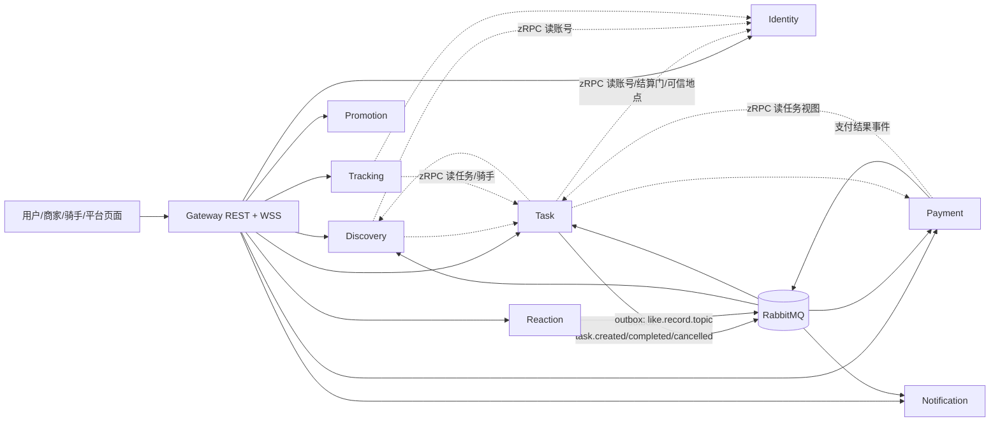

# CityFlow 微服务架构与 go-zero 实施方案

更新日期：2026-11-22。

## 项目目标

CityFlow 是基于 go-zero 的单仓库多服务系统。微服务不是等流量变大后的可选项，而是项目明确的建设目标：每个服务独立进程、独立配置、独立数据库账号、独立迁移和独立健康检查；服务之间只通过 zRPC、事件和稳定契约交互。

当前九个 go-zero 进程已接管全部业务 API、页面与静态资源，旧 Gin 入口已删除。Gateway 是唯一公开入口（REST/WSS），其余八个为内部 zRPC 服务。Gateway 内嵌提供 `web/`，浏览器不直接访问任何内部端口。

go-zero 负责运行框架：REST 使用 go-zero REST，服务间同步调用使用 zRPC，HTTP 契约由 `.api` 描述，RPC 契约由 `.proto` 描述。框架不替代领域建模、数据所有权、事务边界和容量验证。

## 目标服务

| 服务 | 端口 | 负责 |
|---|---|---|
| Gateway | `8087` | HTTP/WSS 入口、鉴权、路由、限流、统一错误、前端页面托管；不保存领域数据 |
| Identity | `8090` | 账号、认证、角色、状态、个人基础资料、骑手注册审批 |
| Discovery | `8092` | 商家、地点、地图、搜索、地点/商家评论、点赞数投影 |
| Reaction | `8097` | 点赞/收藏状态、Redis 热计数、定时批量投影到 MQ |
| Task | `8091` | 履约任务、骑手接单/取货/送达、骑手资料、骑手反馈评论与点赞数投影 |
| Payment | `8094` | 支付单、渠道回调、退款、对账、骑手结算 |
| Promotion | `8098` | 优惠券模板、领取、锁定、核销、退还 |
| Tracking | `8095` / WSS `8093` | 骑手位置、轨迹、GEO、WebSocket 推送 |
| Notification | `8099` | 站内消息、未读数、模板、投递记录，消费任务创建/完成/取消事件 |

`reaction` 是独立服务，统一拥有点赞/收藏状态与计数：Redis 记用户集合和绝对计数，每 20 秒批量发 `like.record.topic`，Discovery/Task 消费后更新各自 `like_count` 投影。评论区仍按正文对象归属，不单独建评论服务。`common` 也不是微服务，它是公共库，只放技术能力与稳定 API 契约。

## 服务调用关系



同步 RPC 只用于需要立即得到结果的查询和命令，例如 Payment 创建支付单时校验任务归属与服务端报价，Task 抢单时校验骑手资格与支付门。跨服务状态传播走 Outbox + RabbitMQ：本地事务提交后可靠发布，消费者幂等处理，失败重试并配置 DLQ。跨服务不使用分布式数据库事务。

## 数据所有权

| 服务 | 权威数据 |
|---|---|
| Identity | `users`、`password_reset_tokens`、`rider_registrations`、`identity_outbox` |
| Discovery | `merchant_profiles`、`merchant_media`、`trusted_places`、`place_reviews`、`place_review_comments` |
| Reaction | 无 MySQL；Redis 点赞集合、计数 ZSET、用户索引与待投影队列 |
| Task | `tasks`、`task_events`、`task_incidents`、`rider_profiles`、`rider_feedback`、`rider_feedback_comments`、`task_outbox` |
| Payment | `payment_orders`、`payment_notifies`、`payment_inbox`、`rider_settlements`、`rider_payout_accounts` |
| Promotion | `coupons`、`coupon_claims` |
| Tracking | `rider_track_points`；Redis 位置快照、GEO、待归档轨迹 ZSET、归档游标 |
| Notification | `notifications`、`notification_templates`、投递/未读状态 |

各服务只写自己的表，不跨库事务、不建跨服务外键、不做跨服务 `ON DELETE CASCADE`。`schema_migrations`、outbox/inbox/audit 表是基础设施表。

同一个 MySQL 实例内使用服务级 schema 和独立账号：

| 数据库 | 账号 |
|---|---|
| `cityflow_identity` | `identity_dev` |
| `cityflow_discovery` | `discovery_dev` |
| `cityflow_task` | `task_dev` |
| `cityflow_payment` | `payment_dev` |
| `cityflow_promotion` | `promotion_dev` |
| `cityflow_notification` | `notification_dev` |
| `cityflow_tracking` | `tracking_dev` |

账号权限由 MySQL 限制，例如 `identity_dev` 不能访问 `cityflow_task`。本地 DSN 默认指向 `127.0.0.1:3307`；初始化脚本 `scripts/db/init-service-databases.ps1` 创建全部库、账号和权限，然后由各服务 `MigrateService` 应用自己的迁移。

## 目录与契约

```text
app/<service>/
├─ cmd/api|cmd/rpc/         goctl 入口、.api/.proto、etc、pb、client、internal/{config,logic,server,svc}
├─ domain/                  服务自己的领域模型与规则
├─ application/             服务自己的用例编排、消费方本地读模型和端口
├─ repository/              服务自己的仓储端口
└─ internal/adapter/        服务自己的 MySQL/Redis/渠道适配器

internal/
├─ common/                  技术能力、通用工具、稳定契约（auth、pagination、outbox、location、contract）
├─ platform/                多服务共享技术组件（mysql、cache、messaging、mq、authn、authctx、httpkit、maps、rpcctx、rpckit 等）
├─ integration/rpcadapt/    跨服务 RPC 读模型适配
├─ migrations/service/      各服务迁移
├─ security/                JWT/密码工具
└─ testfixture/             测试夹具
```

规则：

1. 只供一个服务使用的代码放该服务自己的 `domain/application/repository/internal`。
2. `internal/common` 只放技术能力和稳定 API 契约，不放任务、用户、优惠券等领域对象。
3. `internal/platform` 只放多服务共享技术组件，禁止依赖任何 `app/` 包。
4. HTTP 契约集中在 `app/gateway/cmd/api/gateway.api`；RPC 契约分别是各服务 `cmd/rpc/*.proto`。生成代码只放对应服务 `pb/` 和 `*client/`。
5. 跨服务同步读取走 `internal/integration/rpcadapt`；消费方在 application 层声明本地 DTO 与端口，不 import 对方领域包。
6. Gateway 路由表 `routes.go` 与 `gateway.api` 手工镜像，新增/删除路由必须同时改两处并执行 `goctl api validate`。

## 请求身份上下文

浏览器只拿 Identity 签发的 JWT。Gateway 验签后把 claims 放进标准 `context.Context`，并通过 gRPC metadata 传递 `authorization`；下游服务统一拦截器重新验签、校验账号状态与角色，再写入本次 RPC 的 ctx。下游不能信任客户端自带身份头，也不能把“请求经过网关”当成完整授权。

代码落点：

- `internal/platform/authctx`：`WithClaims(ctx, claims)` / `Claims(ctx)`，私有 context key，不使用包级当前用户变量。
- `internal/platform/authn`：Bearer 提取、JWT 验签、账号 active 检查、zRPC Unary 拦截器、`StatusCache`。
- `internal/platform/rpcctx`：Gateway 调用 zRPC 时写 outgoing metadata。
- `internal/platform/httpkit`：严格 JSON、统一错误形状、分页、gRPC→HTTP 错误映射。
- `internal/platform/rpckit`：gRPC 错误与角色校验。

Gateway 的 `StatusCache` TTL 默认 5 秒，只缓存 active/inactive，不缓存 Identity 不可用错误。账号停用最多延迟一个 TTL 生效；需要更短延迟时调小 `AUTH_STATUS_CACHE_TTL_SECONDS`。

## 事件链路

| 生产者 | 事件 | 消费者与用途 |
|---|---|---|
| Task | `task.created.v1` | Notification 生成“任务已创建，请完成支付”站内消息 |
| Task | `task.completed.v1` / `task.cancelled.v1` | Payment 结算/退款；Notification 生成任务终态消息 |
| Payment | 支付结果 | Task 通过同步支付闸门读取；不维护第二份履约状态 |
| Identity | `rider.approved` | Task 建立骑手履约资料 |
| Tracking | `rider.track.batch.v1` | Tracking 自身的 MySQL 归档消费者；提交成功后删除 Redis 待归档成员 |

事件 envelope 包含事件 ID、聚合 ID、版本、发生时间和 schema 版本；消费者保存幂等记录。本地事务提交后由 outbox relay 发布，发布失败可重试；消费者失败进入重试/DLQ，不无限阻塞主链路。

## 支付与履约边界

- Payment 拥有支付单、渠道回调、退款、对账、结算和提现账户。`payment_orders.active_task_id` 生成列与唯一索引在数据库层保证“一任务一活跃支付单”。
- Task 拥有任务状态机、抢单、取货/送达、异常和骑手反馈。抢单保留只读支付闸门：报价任务必须存在 `PAID` 支付单，否则返回 gRPC `FailedPrecondition`，Gateway 映射为 HTTP 409。
- Task 完成时调用 Payment `EnsureSettlement`；取消时异步触发退款，并把 `cancel_reason` 作为退款原因。Payment 不维护第二份履约状态，Task 抢单时直接读取支付单状态。
- Promotion 拥有优惠券模板、领取、锁定、核销、退还。Payment 在创建支付单时向 Promotion 获取报价快照，不把优惠券金额只信浏览器。
- Tracking 保存位置快照、GEO、Redis 待归档轨迹、MySQL 轨迹归档和 WSS 推送；任务归属由 Task `CanTrack` 校验。上报只写 Redis；RabbitMQ 消费者提交 MySQL 成功后才删除 Redis 成员。

## Gateway 边界

Gateway 只做：

- 入口验签、Cookie 登录态、request ID、访问日志、Recover、限流、统一错误映射、REST 超时。
- 显式 REST 路由和显式 WSS 路由；WSS 反代到 Tracking `8093`，不套 REST 短超时。
- 内嵌 `web/` 页面与静态资源；非 API 页面由 Gateway 提供，未匹配 `/api` 直接 404。

Gateway 不连接任何领域数据库，只持有下游 zRPC client、WSS 地址、JWT secret 和短 TTL `StatusCache`。浏览器不直接访问 `8090/8091/8092/8093/8094/8095/8097/8098/8099`。

WSS 握手使用 `Sec-WebSocket-Protocol: cityflow, bearer.<JWT>`；Gateway 重写为内部路径后反代到 Tracking。Tracking 本地验签、通过 Identity 校验账号 active，再调用 Task `CanTrack` 校验任务归属后订阅骑手。

## 前端应用

一个 Web 应用，按角色分区，不是四个独立前端进程：

```text
web/
├─ shared/      API client、登录鉴权、地图、通用组件、样式
├─ auth/        登录、注册、找回密码
├─ user/        发任务、任务、支付、优惠券、评价、追踪
├─ merchant/    商家工作台、媒体、履约
├─ rider/       骑手注册、工作台、接单、轨迹
├─ platform/    平台用户、商家、骑手、审核、评论治理
├─ assets/      静态资源
└─ uploads/     本地上传目录
```

`web/coupons` 已并入 `web/user/coupons`；`web/assets/shared` 已移到 `web/shared`。Gateway 通过 `go:embed` 托管 `auth user rider merchant platform shared assets`。

## 启动与验证

```powershell
# 构建并启动 Docker 依赖和全部进程
.\scripts\microservices\start-local.ps1 -Build

# 依赖已在运行时跳过 Compose
.\scripts\microservices\start-local.ps1 -Build -SkipDocker

.\scripts\microservices\stop-local.ps1
```

启动顺序：Identity → Task → Discovery → Reaction → Promotion → Payment → Notification → Tracking → Gateway。脚本等待八个 zRPC 端口和 WSS `8093` 全部监听，再启动 Gateway；Gateway `/readyz` 检查下游健康后绑定 `8087`。

当前基线（2026-11-22）：

- 九个进程启动；`/healthz`、`/readyz` 返回 `200 {"status":"ok"}`。
- 四角色登录成功；`/api/v1/auth/me`、优惠券、通知、任务路由经 Gateway 返回 200。
- 通过 `POST /api/v1/tasks` 创建任务；Task outbox 写入 `task.created.v1`，Notification 生成 `TASK_CREATED` 站内消息。
- Payment 支付/结算/inbox 恢复 worker 正常启动；Promotion 迁移和优惠券种子正常。
- `go test ./...`、`go vet ./...` 通过。

## 当前边界与后续

- 真实渠道支付凭证与自动出款尚未接生产；当前使用 Mock/支付宝/微信适配器骨架。
- RabbitMQ 消费重试/DLQ 已封装，但生产级监控、告警和容量压测仍待补。
- Discovery 运行路径只装配高德 provider；`maps.Local`/`maps.Hybrid` 和 PostGIS 代码保留，尚未接入运行路径。
- 任务创建即进入 `OPEN`，未支付任务会出现在骑手列表；抢单时由支付闸门拒绝未支付任务。是否改为支付后开放仍需产品决策。
- Identity 审批骑手 outbox 到 Task 资料的队列绑定已实现，尚需在完整审批流程中持续回归。
- 十万 QPS 是压测目标，当前没有压测数据，不得宣称已支持。

## 不作为目标的做法

- 不恢复 `services/<name>/main.go` 手写多入口。
- 不把 `internal/application|domain|infrastructure` 当共享业务层；领域代码归服务。
- 不让服务互查数据库、共享业务表或跨库 JOIN。
- 保持 Reaction 为独立 Redis 服务，不并回 Gateway 或内容服务；商家点赞/热榜不进入通用 Reaction。
- 不把前端拆成多个独立进程。
- 不用“目录分得多”冒充微服务；每个服务必须能独立启动、测试、迁移和部署。


